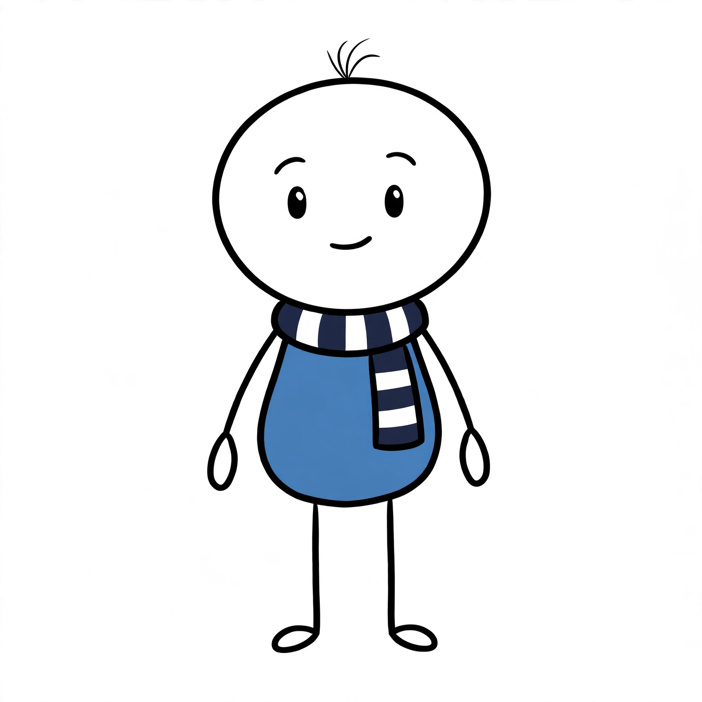

# 13 — Kế hoạch làm kho hình bằng Muse (bản web, làm tay)

Mục tiêu: trong **4 tuần đầu** có kho lõi ~300 ảnh đồng bộ một phong cách; sau đó mỗi video chỉ bổ sung 5–15 ảnh theo chủ đề. Đến hết tháng thứ 3 kho đạt ~500 ảnh, đủ dựng 2 video dài / tuần + Shorts.

Công cụ: **Muse bản web** (`muse.ai`), tài khoản của chính người dùng, gửi tay từng lô. Không dùng công cụ tự động hoá / nhiều tài khoản (xem lý do ở mục 8). Quy tắc phong cách gốc vẫn là [`04-TAO-ANH-GEMINI.md`](04-TAO-ANH-GEMINI.md) — tài liệu này chỉ đổi công cụ và chia lô.

Số liệu nền (đếm từ 2 kịch bản "fortune tellers", ~10 phút, ~120 cảnh): một video dùng **~31 ảnh khác nhau** — ~15 ảnh Max / Brainy / Sam, 4–5 nền, ~15 đạo cụ riêng chủ đề.

---

## 1. Quy trình mỗi buổi làm

**Cách nhanh cho phần nhân vật:** kéo cả 3 tệp trong `gui-muse/` (`CHARACTER-BRIEF.md`, `IMAGE-1-proportions.png`, `IMAGE-2-expressions.png`) vào khung chat Muse → Muse trả lời "ready" → gõ `STEP 1` rồi `STEP 2`… Tệp này gộp sẵn mục 2, 2b và lô 0–2 bằng tiếng Anh. Muse không nhận tệp `.md` thì đổi đuôi thành `.txt`.

1. Mở **cuộc trò chuyện mới** trên Muse cho mỗi lô (Muse "trôi" phong cách khi chat quá dài).
2. **Đính kèm ảnh tham chiếu** (chi tiết mục 2b):
   - mọi lô có Max: **`kho-mau/_mau-nhan-vat/max-goc.png`** (Max đã chốt 2026-11-14) + `max-sheet.png` khi đã làm xong lô 0A + bảng biểu cảm có chứa biểu cảm đang vẽ;
   - nhân vật phụ: bảng của chính nhân vật đó + `max-sheet.png`.
3. Dán **Bản giao việc** (mục 2) — một lần đầu mỗi cuộc trò chuyện.
4. Dán **khối lô** (mục 4). Muse vẽ lần lượt **mỗi lần trả lời một ảnh**, ghi dòng `FILE: ...` trước ảnh.
5. Sau mỗi ảnh gõ:
   - `ok` → ảnh đạt, Muse làm mục kế tiếp;
   - `redo: <lý do ngắn>` → vẽ lại mục đó (vd. `redo: shadow under feet`, `redo: body must be plain blue #487EB9`);
   - `skip` → bỏ qua, ghi lại để làm sau.
6. Tải ảnh về (bản đầy đủ), **đổi tên đúng dòng `FILE:`** (chỉ lấy phần tên, không có thư mục), lưu vào:
   - nhân vật → `kho-mau/_cho-xu-ly/nhan-vat/`
   - đạo cụ, ký hiệu → `kho-mau/_cho-xu-ly/dao-cu/`
   - biểu đồ → `kho-mau/_cho-xu-ly/bieu-do/`
   - nền cảnh → chép thẳng vào `kho-mau/phong-nen/` (không tách nền)
7. Cuối buổi nhờ Claude (hoặc tab **Kho hình** trong `giao-dien.bat`): tách nền từng thư mục → `nq kho` → mở vài ảnh kiểm (mục 6). Ảnh hỏng thì ghi vào danh sách làm lại.

Muse chỉ cho ảnh định dạng `.webp` cũng được — `nq tach-nen` / `nq kho` đọc `.png .jpg .jpeg .webp`.

---

## 2. Bản giao việc gửi Muse (dán đầu mỗi cuộc trò chuyện)

```text
You are the illustrator for an original YouTube channel of 2D animated psychology explainers for ADULTS (work, money, relationships, habits, social media). I will send you batches of assets. Draw them ONE AT A TIME, in the listed order, one image per reply.

PROTOCOL
- Before each image, write one line exactly: FILE: <the filename from my list>
- Then the image. Then stop and wait.
- I reply "ok" (next item), "redo: <reason>" (draw the same item again, fixing it), or "skip".
- You decide composition, small details and how to make each item instantly readable — be creative inside the style rules. If an item is vague, pick the most recognizable everyday version.

STYLE BIBLE (never break)
- Flat 2D vector cartoon, thick uniform black outlines (same weight everywhere), flat colors, NO gradients, NO shading, NO shadows (not even under feet), NO texture, NO paper grain.
- Palette: blue #487EB9 (reserved for Max's body only), navy #1F2A44, teal #2EC4B6, orange #FF7A1A, mustard #F2B33D, coral #E8735A, off-white #F5F1E8, black #111111, plus muted accents: soft green #4CAF50, soft red #E53935, warm yellow #FFC93C, soft pink #F4A7B9, light grey #BDBDBD, charcoal #4A4A4A, beige #E8D5B5.
- Characters: very simple stick figures: a big white oval head (about 40% of height, no hair unless specified, no ears, no nose, no neck), small solid black vertical oval eyes, thin curved eyebrows, one-line mouth, one plain colored rounded egg-shaped body, thin black stick arms and legs, small white oval hands and feet. Always match the attached character sheet exactly.
- Characters, props, charts, symbols: ONE subject per image, centered, full subject visible, generous empty margin, PURE WHITE background #FFFFFF, square 1:1.
- Backgrounds (only when the batch says BACKGROUND): wide 16:9, off-white #F5F1E8 base, thin light grey #BDBDBD outlines, very sparse details, empty center and lower half for characters, no people.
- NO text, letters, numbers, logos, brand names, flags, watermarks or borders anywhere. Screens, signs, papers, labels stay blank or use simple lines/shapes.
- Adult everyday world. Nothing childish (no school, toys, cartoon animals as heroes), no gore, no weapons, no real people, no existing characters or brands.
- Closed outlines everywhere (a white area inside a shape must be fully enclosed by black line) so the background can be removed cleanly.

Reply "ready" and wait for the first batch.
```

---

## 2b. Ảnh mẫu nhân vật — định dạng "bảng nhân vật"

Mọi nhân vật làm theo **đúng định dạng bảng dưới đây**: ảnh ngang 16:9, **bên trái một hình toàn thân đứng thẳng nhìn thẳng**, **bên phải lưới 2×2 bốn đầu biểu cảm** (chỉ đầu, không thân), nền trắng, không chữ. Bảng này là "giấy khai sinh" của nhân vật: làm một lần, chốt, rồi **đính kèm vào mọi lần vẽ sau** để Muse giữ đúng mặt, thân, nét vẽ.

**Max đã chốt (2026-11-14)** — `kho-mau/_mau-nhan-vat/max-goc.png` (bản sao gửi Muse: `gui-muse/IMAGE-1-max.png`). Kiểu biểu cảm tham khảo thêm `max-bieu-cam-mau.png` (bản thử cũ, chỉ lấy mặt — thân trong đó lỗi thời):



Đặc điểm (đã chép vào khối `CHARACTER SPEC` bên dưới):
- **Đầu**: bầu dục trắng to (hơi bè ngang), viền đen mảnh, khoảng 40% chiều cao, rộng hơn thân; **không tai, không mũi, không cổ**.
- **Tóc**: chỉ **3–4 sợi xoăn mảnh** dựng trên đỉnh đầu.
- **Khăn quàng** (nhận diện): sọc **navy `#1F2A44` – trắng**, quấn quanh cổ như cổ áo (sọc dọc), **một đầu thả trước ngực phía phải người xem** (sọc ngang, chóp navy), viền đen dày.
- **Mặt**: mắt là hai bầu dục đen đặc nhỏ dựng đứng, có một chấm sáng trắng; lông mày là nét cong mảnh; miệng một nét.
- **Biểu cảm thêm**: má hồng bầu dục `#EDBBBC` (ngượng), giọt mồ hôi xanh nhạt `#C9E8FA` (lo), nét rung cong hai bên đầu (sốc).
- **Thân**: một khối xanh `#487EB9` (đo từ ảnh) bo tròn hình quả trứng / quả lê — hẹp ở chỗ nối đầu, tròn bè ở dưới; khoảng 1/3 chiều cao; **không chi tiết quần áo**.
- **Tay chân**: đều là **nét que đen mảnh**; tay mọc từ hai bên phía trên thân; bàn tay là bầu dục trắng nhỏ dựng đứng, bàn chân là bầu dục trắng nằm ngang, viền đen.
- **Nét vẽ**: viền đen mảnh-vừa, sạch, đều; màu phẳng; không bóng.

Thân xanh `#487EB9` và khăn sọc navy–trắng dành riêng cho Max — nhân vật khác không dùng. Tay chân que nên code vẽ và xoay khớp dễ (`docs/10`).

Khối mô tả dán kèm **mọi** lô có Max (đặt ngay dưới dòng `BATCH ...`):

```text
CHARACTER SPEC — MAX (match the attached sheet exactly):
very simple stick figure. Head: a big white oval (slightly wider than tall) with a clean black outline, about 40% of total height, wider than the body. NO ears, NO nose, NO neck.
Hair: only 3-4 thin curly black strands sticking up from the top center.
Scarf: navy #1F2A44 and white striped scarf wrapped around the neck like a collar, one end hanging down the front on the viewer's right with horizontal stripes and a navy tip.
Eyes: two small solid black vertical ovals, each with one small white highlight dot. Eyebrows: short thin curved black strokes. Mouth: one thin black line.
Emotion extras: soft pink oval blush (shy), a small light-blue sweat drop (anxious), short curved shake lines beside the head (shocked).
Body: one plain blue #487EB9 rounded egg / pear shape (narrow at the top under the scarf, round at the bottom), about 1/3 of the height, NO clothing details.
Arms: two thin black stick lines from the upper sides of the body; hands: small white vertical ovals. Legs: two thin black stick lines; feet: small white horizontal ovals.
Clean uniform black outlines, flat colors, no shading, no shadows. Every white area enclosed by a closed black outline.
```

Mô tả đầy đủ, dạng tài liệu gửi kèm ảnh: `gui-muse/CHARACTER-BRIEF.md`.

Các nhân vật khác chưa có mẫu → bảng nhân vật của họ làm ở lô 0C. Sau khi chốt, viết thêm một khối `CHARACTER SPEC — <TÊN>` theo cùng mẫu (nhờ Claude nhìn bảng đã chốt rồi viết), lưu vào mục này.

**Vì sao ảnh sản xuất vẫn là ảnh đơn 1:1?** Luồng dựng đặt mỗi nhân vật thành một lớp riêng. `nq tach-nen` chỉ cắt **một chủ thể mỗi ảnh**, chưa tách được bảng nhiều hình. Vì vậy bảng nhân vật chỉ dùng làm **tham chiếu** (lưu trong `_mau-nhan-vat/`, `nq kho` bỏ qua thư mục bắt đầu bằng `_`). Ảnh đưa vào video vẫn vẽ từng hình 1:1 ở lô 1 trở đi.

---

## 3. Thứ tự lô và khối lượng

| Lô | Nội dung | Số ảnh | Tuần |
|---|---|---|---|
| 0 | Bảng nhân vật (Max đã có; còn 3 bảng biểu cảm + 4 nhân vật phụ) + 5 ảnh gốc 1:1 | 12 | 1 |
| 1 | Max × 16 biểu cảm, tư thế đứng | 16 | 1 |
| 2 | Max × tư thế khác | 28 | 1 |
| 3 | Brainy, Sam, sếp, bạn hẹn, đám đông | 37 | 2 |
| 4 | Nền cảnh | 25 | 2 |
| 5 | Đạo cụ: tiền & mua sắm | 28 | 2 |
| 6 | Đạo cụ: công việc | 22 | 3 |
| 7 | Đạo cụ: điện thoại & mạng xã hội | 22 | 3 |
| 8 | Đạo cụ: quan hệ & cảm xúc, nhà cửa & ăn uống | 38 | 3 |
| 9 | Đạo cụ: thói quen & sức khoẻ, nghiên cứu | 28 | 4 |
| 10 | Biểu tượng tâm lý | 28 | 4 |
| 11 | Biểu đồ + ký hiệu / hiệu ứng | 28 | 4 |
| — | **Kho lõi** | **~313** (8 bảng tham chiếu + ~305 ảnh dùng trong video) | |
| V | Gói theo từng video (mục 5) | 5–15 / video | từ tuần 2 |

Ước tính 3–5 phút / ảnh (gồm vẽ lại + đổi tên) → kho lõi ~15–25 giờ, chia 4 tuần ≈ 1 giờ / ngày. Video 1 đăng được cuối tuần 2 (đã có lô 0–4 + đạo cụ của chủ đề đó); kho thiếu thì `nq hinh-tam` vẽ hình tạm cùng tên để vẫn dựng thử được.

---

## 4. Khối lô (dán nguyên khối sau Bản giao việc)

Tên tệp theo `docs/04` mục 9: chữ thường không dấu, `nhan-vat/<ten>__<bieu-cam>__<tu-the>.png`. Mã biểu cảm / tư thế: `docs/04` bảng 3, 4 (tư thế `ngoi` = ngồi sofa / ghế, đã có trong `nq hinh-tam`).

### Lô 0 — Bảng nhân vật (định dạng như ảnh mẫu, mục 2b)

Bảng 16:9 **không tách nền**. Tải về rồi lưu thẳng vào `kho-mau/_mau-nhan-vat/` đúng tên `FILE:`. Mỗi bảng nên vẽ 2–4 lần và chọn bản đẹp nhất; mỗi lần vẽ lại một bảng **mở cuộc trò chuyện mới** (theo kinh nghiệm ở `_mau-nhan-vat/README.md`, vẽ lại trong cùng cuộc trò chuyện thì ra gần như y hệt).

**Ảnh đơn Max: ĐÃ CÓ.** `max-goc.png` vốn là ảnh 1:1 nền trắng. Chép vào `kho-mau/_cho-xu-ly/nhan-vat/max__goc__dung.png` rồi tách nền là dùng được, không cần Muse vẽ lại.

**0A — Bảng gốc Max** (đính kèm `max-goc.png` + `max-bieu-cam-mau.png`, dán khối `CHARACTER SPEC — MAX`). Bảng này gom thiết kế cuối và 4 biểu cảm mẫu vào một ảnh, làm tham chiếu cho mọi lô sau:

```text
BATCH 0A — CHARACTER SHEET (wide 16:9, pure white background, no text, no labels).
LEFT: Max full body exactly as the first attached image (hair tuft, striped scarf, blue body, stick limbs). Only ONE full-body figure.
RIGHT: a 2x2 grid of head-only close-ups, layout and expression style like the right side of the second attached image, but with Max's 3-4 curly hair strands and eye highlight dots: top-left happy · top-right anxious (worried eyebrows, wavy mouth, sweat drop) · bottom-left shocked (small open oval mouth, shake lines) · bottom-right embarrassed (pink blush, eyes looking aside, awkward smile).
Ignore the body of the second image (it is outdated).
1. FILE: max-sheet.png
```

**0B — Bảng biểu cảm Max** (đính kèm `max-sheet.png`, dán khối `CHARACTER SPEC — MAX`). Mỗi bảng là lưới 2×2 chỉ có đầu, giống nửa phải của `max-sheet.png`, đủ 12 biểu cảm còn lại. Lô 1–2 dùng các bảng này làm tham chiếu biểu cảm.

```text
BATCH 0B — EXPRESSION SHEETS (wide 16:9, pure white background, no text, no labels). Each sheet is a 2x2 grid of head close-ups of the SAME Max as the attached sheet (white oval head with the 3-4 curly hair strands, no body), exactly like the right side of the attached sheet: evenly spaced, same size, same framing. Expressions clear and readable using eyebrows, eye size, mouth and small extras (sweat drops, tears, sparkles, puffs).
1. FILE: max-bieu-cam-1.png — top-left greedy (eyes as small sparkles, eager wide grin) · top-right panicked (bigger eyes, mouth open screaming, sweat drops flying) · bottom-left regretful (eyes looking down, sad mouth) · bottom-right confident (smirk, one eyebrow raised)
2. FILE: max-bieu-cam-2.png — top-left confused (one eyebrow up, wavy mouth, head tilted) · top-right thinking (eyes looking up to the side, small flat mouth) · bottom-left sad (droopy eyebrows, downturned mouth, one tear) · bottom-right angry (sharp slanted eyebrows, gritted-teeth line, small steam puff)
3. FILE: max-bieu-cam-3.png — top-left relieved (eyes closed as curves, gentle smile, small exhale puff) · top-right smug (half-closed eyes, one-sided smirk) · bottom-left excited (sparkling eyes, huge open smile) · bottom-right bored (half-closed flat eyes, flat mouth)
```

`max-sheet.png` đã có 4 biểu cảm: vui (`vui`), lo âu với miệng lượn sóng + giọt mồ hôi (`lo-lang`), sốc (`soc`), ngượng má hồng. `so-hai` dùng mặt `lo-lang` đẩy mạnh hơn (mắt to hơn, người co lại).

**0C — Bảng nhân vật phụ** (mỗi nhân vật một cuộc trò chuyện; đính kèm `max-sheet.png` (hoặc `max-goc.png` nếu chưa có bảng) làm chuẩn phong cách, tuyệt đối không dùng thân xanh và khăn sọc):

```text
BATCH 0C — CHARACTER SHEET for a NEW character, in exactly the same style and the SAME LAYOUT as the attached Max sheet (wide 16:9: LEFT full body standing facing the viewer, arms relaxed; RIGHT 2x2 head-only close-up grid: happy, anxious, shocked, confused). Same build: big white oval head, same small black oval eyes and thin eyebrows, one plain colored rounded egg-shaped body, thin stick arms and legs, small white oval hands and feet, same line weight. Pure white background, no text, no labels. The new character must look clearly different from Max at a glance and its body must NOT be blue #487EB9 and it must NOT wear a striped scarf.
```
Rồi chọn **một** dòng dưới (mỗi lần một nhân vật):
```text
1. FILE: brainy-sheet.png — Brainy, Max's inner voice: a small soft-pink #F4A7B9 cartoon brain with a few fold lines instead of a round head, the same small oval eyes and thin eyebrows, thin black stick arms and legs with small white oval hands and feet. Curious, slightly mischievous. Clearly a cartoon brain, not a doctor (no glasses, no lab coat).
2. FILE: ban-sheet.png — Sam, Max's friend: a small tuft of curly black hair on top of the round head, mustard #F2B33D crew-neck sweater with no hood.
3. FILE: sep-sheet.png — the boss: slightly taller, neat grey hair at the sides of the round head, charcoal #4A4A4A blazer over a white shirt with a soft red #E53935 tie.
4. FILE: nguoi-hen-sheet.png — Ava, Max's date / partner: a simple black ponytail on the round head, coral #E8735A cardigan.
```
Chốt từng bảng xong thì xin ảnh đơn 1:1 toàn thân: `nhan-vat/brainy__goc__dung.png`, `nhan-vat/ban__goc__dung.png`, `nhan-vat/sep__goc__dung.png`, `nhan-vat/nguoi-hen__goc__dung.png`.

### Lô 1 — Max × 16 biểu cảm (đính kèm `max-sheet.png` + bảng biểu cảm chứa biểu cảm đang vẽ)

Chia làm 4 cuộc trò chuyện theo bảng biểu cảm: mục 1, 3, 8, 14 đi với `max-sheet.png`; mục 2, 4, 5, 6 với `max-bieu-cam-1.png`; mục 7, 9, 10, 11 với `max-bieu-cam-2.png`; mục 12, 13, 15, 16 với `max-bieu-cam-3.png`. Dán khối `CHARACTER SPEC — MAX` dưới dòng `BATCH`.

```text
BATCH 1 — Max, same character as the attached sheet; copy the matching face from the attached expression sheet (same white oval head with 3-4 curly hair strands, small oval eyes with highlight dots, navy-white striped scarf, plain blue #487EB9 egg-shaped body, stick arms and legs, white oval hands and feet). Pose for all: standing, facing the viewer, arms relaxed (arms may move only if the expression needs it). The face is minimal, so push each emotion with body language too.
1. FILE: nhan-vat/max__vui__dung.png — happy, big simple smile
2. FILE: nhan-vat/max__tham-lam__dung.png — greedy, wide hungry grin, sparkly eyes, leaning forward
3. FILE: nhan-vat/max__so-hai__dung.png — fearful, eyes wide, small wavy open mouth, shrinking back
4. FILE: nhan-vat/max__hoang-loan__dung.png — panicked, huge eyes, mouth wide open screaming, sweat drops flying
5. FILE: nhan-vat/max__hoi-han__dung.png — regretful, looking down, sad mouth, slumped shoulders
6. FILE: nhan-vat/max__tu-tin__dung.png — confident, slight smirk, chin up, chest out
7. FILE: nhan-vat/max__boi-roi__dung.png — confused, one eyebrow raised, squiggly mouth, head tilted
8. FILE: nhan-vat/max__soc__dung.png — shocked, eyes extremely wide, mouth a big round O, short motion lines around head
9. FILE: nhan-vat/max__suy-nghi__dung.png — thinking, eyes up to the side, one hand on chin
10. FILE: nhan-vat/max__buon__dung.png — sad, droopy eyes, downturned mouth, one small tear
11. FILE: nhan-vat/max__gian__dung.png — angry, slanted eyebrows, gritted teeth, small steam puffs above head
12. FILE: nhan-vat/max__nhe-nhom__dung.png — relieved, eyes closed, gentle smile, small exhale puff
13. FILE: nhan-vat/max__dac-y__dung.png — smug, half-closed eyes, one-sided smirk, arms crossed
14. FILE: nhan-vat/max__lo-lang__dung.png — anxious, worried eyebrows, wobbly mouth, one sweat drop
15. FILE: nhan-vat/max__hao-hung__dung.png — excited, sparkling eyes, huge open smile, arms raised
16. FILE: nhan-vat/max__chan__dung.png — bored, half-closed eyes, flat mouth, shoulders sagging
```

### Lô 2 — Max × tư thế khác (đính kèm `max-sheet.png` + bảng biểu cảm liên quan, dán `CHARACTER SPEC — MAX`)

Chọn theo tần suất trong kịch bản đã viết (ngồi máy tính, cầm điện thoại, đi bộ dùng nhiều nhất sau đứng).

```text
BATCH 2 — Max, same character as the attached reference. Furniture and devices drawn in the same thick black line style; screens blank or showing only simple shapes.
1. FILE: nhan-vat/max__suy-nghi__ngoi-may-tinh.png — thinking, sitting on a simple chair at a simple desk looking at an open laptop
2. FILE: nhan-vat/max__lo-lang__ngoi-may-tinh.png — anxious, same desk setup
3. FILE: nhan-vat/max__soc__ngoi-may-tinh.png — shocked, leaning back from the laptop
4. FILE: nhan-vat/max__vui__ngoi-may-tinh.png — happy, typing
5. FILE: nhan-vat/max__chan__ngoi-may-tinh.png — bored, head resting on one hand
6. FILE: nhan-vat/max__hao-hung__ngoi-may-tinh.png — excited, fists up
7. FILE: nhan-vat/max__lo-lang__cam-dien-thoai.png — anxious, holding a smartphone in front of the face, screen shows a simple line chart
8. FILE: nhan-vat/max__soc__cam-dien-thoai.png — shocked, same phone pose
9. FILE: nhan-vat/max__vui__cam-dien-thoai.png — happy, scrolling the phone
10. FILE: nhan-vat/max__tham-lam__cam-dien-thoai.png — greedy, eyes glued to the phone
11. FILE: nhan-vat/max__boi-roi__cam-dien-thoai.png — confused, looking at the phone
12. FILE: nhan-vat/max__hao-hung__cam-dien-thoai.png — excited, phone raised
13. FILE: nhan-vat/max__vui__di-bo.png — happy, walking to the right, side view, arms swinging
14. FILE: nhan-vat/max__suy-nghi__di-bo.png — thinking, walking to the right
15. FILE: nhan-vat/max__lo-lang__di-bo.png — anxious, walking fast to the right
16. FILE: nhan-vat/max__buon__di-bo.png — sad, walking slowly to the right, head down
17. FILE: nhan-vat/max__tu-tin__chi-tay.png — confident, standing and pointing to the right with one arm fully extended
18. FILE: nhan-vat/max__vui__chi-tay.png — happy, pointing to the right
19. FILE: nhan-vat/max__soc__chi-tay.png — shocked, pointing to the right
20. FILE: nhan-vat/max__hao-hung__chi-tay.png — excited, pointing to the right
21. FILE: nhan-vat/max__hoang-loan__om-dau.png — panicked, both hands holding the head
22. FILE: nhan-vat/max__hoi-han__om-dau.png — regretful, hands on head, looking down
23. FILE: nhan-vat/max__lo-lang__om-dau.png — anxious, hands on head
24. FILE: nhan-vat/max__buon__om-dau.png — sad, hands on head
25. FILE: nhan-vat/max__chan__ngoi.png — bored, slumped on a simple sofa
26. FILE: nhan-vat/max__buon__ngoi.png — sad, sitting on a simple chair, elbows on knees
27. FILE: nhan-vat/max__vui__ngoi.png — happy, relaxed on a simple sofa
28. FILE: nhan-vat/max__lo-lang__ngoi.png — anxious, sitting on the edge of a chair
```

### Lô 3 — Nhân vật phụ (đính kèm `<ten>-sheet.png` của nhân vật đó + `max-sheet.png`)

Mỗi nhân vật một cuộc trò chuyện riêng là tốt nhất; dán phần của nhân vật đó.

```text
BATCH 3A — Brainy, same character as the attached Brainy reference.
1. FILE: nhan-vat/brainy__vui__dung.png — happy, standing
2. FILE: nhan-vat/brainy__vui__chi-tay.png — happy, pointing to the right with one stick arm
3. FILE: nhan-vat/brainy__tu-tin__chi-tay.png — confident, pointing to the right, like presenting a finding
4. FILE: nhan-vat/brainy__suy-nghi__dung.png — thinking, hand on chin
5. FILE: nhan-vat/brainy__boi-roi__chi-tay.png — confused, pointing to the right, one eyebrow up
6. FILE: nhan-vat/brainy__soc__dung.png — shocked, round O mouth
7. FILE: nhan-vat/brainy__hoang-loan__om-dau.png — panicked, hands on its head
8. FILE: nhan-vat/brainy__dac-y__dung.png — smug, arms crossed
9. FILE: nhan-vat/brainy__hao-hung__dung.png — excited, arms raised, a small light bulb idea moment (no bulb drawn, just the pose)
10. FILE: nhan-vat/brainy__lo-lang__dung.png — anxious, sweat drop
11. FILE: nhan-vat/brainy__buon__dung.png — sad, droopy
12. FILE: nhan-vat/brainy__tu-tin__dung.png — confident, chest out

BATCH 3B — Sam, same character as the attached Sam reference.
1. FILE: nhan-vat/ban__vui__dung.png — happy, one hand waving
2. FILE: nhan-vat/ban__tu-tin__dung.png — confident
3. FILE: nhan-vat/ban__soc__dung.png — shocked
4. FILE: nhan-vat/ban__boi-roi__dung.png — confused
5. FILE: nhan-vat/ban__buon__dung.png — sad
6. FILE: nhan-vat/ban__hao-hung__dung.png — excited
7. FILE: nhan-vat/ban__vui__cam-dien-thoai.png — happy, showing a phone screen to someone on the left
8. FILE: nhan-vat/ban__suy-nghi__ngoi-may-tinh.png — thinking at a desk with laptop

BATCH 3C — the boss, same character as the attached boss reference.
1. FILE: nhan-vat/sep__tu-tin__dung.png
2. FILE: nhan-vat/sep__gian__dung.png — angry, arms crossed
3. FILE: nhan-vat/sep__vui__dung.png
4. FILE: nhan-vat/sep__tu-tin__chi-tay.png — pointing to the right, like assigning a task
5. FILE: nhan-vat/sep__boi-roi__dung.png
6. FILE: nhan-vat/sep__soc__dung.png

BATCH 3D — Ava, same character as the attached Ava reference.
1. FILE: nhan-vat/nguoi-hen__vui__dung.png
2. FILE: nhan-vat/nguoi-hen__boi-roi__dung.png
3. FILE: nhan-vat/nguoi-hen__buon__dung.png
4. FILE: nhan-vat/nguoi-hen__gian__dung.png
5. FILE: nhan-vat/nguoi-hen__hao-hung__dung.png
6. FILE: nhan-vat/nguoi-hen__vui__ngoi.png — sitting at a small café table, smiling

BATCH 3E — crowds, same stick-figure style as the attached Max sheet (white oval heads, small oval eyes, rounded egg-shaped bodies, stick arms and legs). 7 simple background adults, a few with simple hair shapes, bodies in muted colors (grey, beige, olive, charcoal, mustard, teal — NO blue #487EB9, NO striped scarves). Wide 16:9 for these five.
1. FILE: nhan-vat/dam-dong__hao-hung__chay.png — excited, all running to the right
2. FILE: nhan-vat/dam-dong__hoang-loan__bo-chay.png — panicked, running away to the left
3. FILE: nhan-vat/dam-dong__hao-hung__nhin-len.png — excited, all looking up at the same point
4. FILE: nhan-vat/dam-dong__vui__dung.png — calm, standing in a loose group
5. FILE: nhan-vat/dam-dong__boi-roi__nhin-len.png — confused, looking up
```

### Lô 4 — Nền cảnh (BACKGROUND, 16:9, không tách nền)

Đủ để mỗi video đổi bối cảnh, khác 3 video gần nhất (`docs/12` mục 2).

```text
BATCH 4 — BACKGROUNDS (wide 16:9, follow the background rules: off-white base, thin light grey outlines, sparse, empty center and lower half, no people, no text).
1. FILE: phong-nen/phong.png — small apartment living room, sofa on the left, window on the right
2. FILE: phong-nen/phong-ngu.png — bedroom at night, bed and a window with a moon
3. FILE: phong-nen/bep.png — small apartment kitchen, counter and fridge at the edges
4. FILE: phong-nen/ban-cong.png — apartment balcony at dusk, railing, city silhouette far away
5. FILE: phong-nen/van-phong.png — open office, desk with monitor and a potted plant at the edges
6. FILE: phong-nen/phong-hop.png — meeting room, long table, blank screen on the wall
7. FILE: phong-nen/quan-ca-phe.png — cozy café, counter in the back, small round tables at the sides
8. FILE: phong-nen/sieu-thi.png — supermarket aisle with shelves of simple blank boxes
9. FILE: phong-nen/trung-tam-thuong-mai.png — shopping mall corridor with blank shop windows
10. FILE: phong-nen/duong-pho.png — city street, simple buildings, sidewalk
11. FILE: phong-nen/tram-xe-buyt.png — bus stop with a bench and a blank sign
12. FILE: phong-nen/trong-tau-dien.png — inside a subway car, seats and hand straps
13. FILE: phong-nen/cong-vien.png — park with trees and a bench
14. FILE: phong-nen/nha-hang.png — restaurant, table for two with a candle, warm mood
15. FILE: phong-nen/phong-gym.png — gym with a treadmill and weights at the edges
16. FILE: phong-nen/ngan-hang.png — bank lobby with a counter and blank screens
17. FILE: phong-nen/rap-phim.png — movie theater, rows of seats, blank screen
18. FILE: phong-nen/san-giao-dich.png — trading floor, row of large blank screens
19. FILE: phong-nen/phong-thi-nghiem.png — psychology lab, plain table, two chairs, one-way mirror
20. FILE: phong-nen/thu-vien.png — library with tall bookshelves at the sides
21. FILE: phong-nen/san-khau.png — empty stage with simple curtains
22. FILE: phong-nen/san-bay.png — airport gate, big window with a plane outside
23. FILE: phong-nen/hoi-cho-dem.png — night market, simple stalls with string lights
24. FILE: phong-nen/leu-xem-boi.png — small fortune-teller tent interior, round table, draped fabric
25. FILE: phong-nen/khong-gian-trong-dau.png — abstract "inside the mind" space: soft swirls and floating simple shapes, very light
```

### Lô 5–11 — Đạo cụ, biểu đồ, ký hiệu (1:1, nền trắng)

Mở đầu mỗi khối bằng dòng chung:

```text
BATCH <số> — PROPS (square 1:1, pure white background, one object, follow the style bible; no text or numbers on any object).
```

rồi dán danh sách tương ứng. **Ô cuối mỗi khối**: nhờ Muse tự đề xuất thêm (mục 4.8).

#### 4.1 Lô 5 — Tiền & mua sắm
```text
1. FILE: dao-cu/tien.png — small stack of banknotes, light green
2. FILE: dao-cu/bao-tien.png — money bag tied at the top, beige, no symbol
3. FILE: dao-cu/dong-xu.png — pile of three gold coins, plain faces
4. FILE: dao-cu/vi-tien.png — open wallet with a few notes sticking out
5. FILE: dao-cu/vi-rong.png — open empty wallet, a small moth flying out
6. FILE: dao-cu/the-ngan-hang.png — plain bank card, chip only
7. FILE: dao-cu/heo-dat.png — piggy bank
8. FILE: dao-cu/hoa-don.png — long paper receipt with blank lines
9. FILE: dao-cu/gio-hang.png — shopping basket full of simple items
10. FILE: dao-cu/xe-day.png — supermarket cart
11. FILE: dao-cu/tui-mua-sam.png — two shopping bags, teal and navy
12. FILE: dao-cu/nhan-gia.png — blank price tag on a string
13. FILE: dao-cu/nhan-giam-gia.png — price tag with a big red slash mark (no numbers)
14. FILE: dao-cu/ket-sat.png — small safe with a dial
15. FILE: dao-cu/may-tinh-bo-tui.png — pocket calculator, blank screen, plain buttons
16. FILE: dao-cu/hop-qua.png — gift box with ribbon
17. FILE: dao-cu/ve-so.png — scratch lottery ticket with plain shapes
18. FILE: dao-cu/xuc-xac.png — two dice
19. FILE: dao-cu/banh-xe-quay.png — spinning prize wheel with colored segments, no numbers
20. FILE: dao-cu/co-phieu-xanh.png — rounded card with a bold upward arrow, green
21. FILE: dao-cu/co-phieu-do.png — rounded card with a bold downward arrow, red
22. FILE: dao-cu/mui-ten-len.png — bold upward arrow, green
23. FILE: dao-cu/mui-ten-xuong.png — bold downward arrow, red
24. FILE: dao-cu/can.png — balance scale, perfectly level
25. FILE: dao-cu/can-lech.png — balance scale, left pan clearly lower
26. FILE: dao-cu/tien-bay.png — banknote with small wings flying away
27. FILE: dao-cu/mua-tien.png — banknotes raining down
28. FILE: dao-cu/the-tin-dung-chay.png — bank card with a small cartoon flame on it
```

#### 4.2 Lô 6 — Công việc
```text
1. FILE: dao-cu/may-tinh.png — open laptop seen from the front-side, blank screen
2. FILE: dao-cu/ban-lam-viec.png — simple office desk
3. FILE: dao-cu/ghe-van-phong.png — office chair
4. FILE: dao-cu/chong-ho-so.png — tall wobbly stack of papers
5. FILE: dao-cu/so-tay.png — notebook with blank lines
6. FILE: dao-cu/but.png — pen
7. FILE: dao-cu/lich.png — wall calendar with blank squares
8. FILE: dao-cu/dong-ho.png — round wall clock, no numbers
9. FILE: dao-cu/dong-ho-cat.png — hourglass with yellow sand
10. FILE: dao-cu/dong-ho-bao-thuc.png — ringing alarm clock with shake lines
11. FILE: dao-cu/coc-ca-phe.png — takeaway coffee cup, plain
12. FILE: dao-cu/cap-tai-lieu.png — briefcase
13. FILE: dao-cu/bai-thuyet-trinh.png — flipchart on a stand with a simple rising bar shape
14. FILE: dao-cu/bang-trang.png — blank whiteboard on legs
15. FILE: dao-cu/phong-bi.png — envelope
16. FILE: dao-cu/thu-muc.png — folder with papers
17. FILE: dao-cu/danh-sach-viec.png — checklist paper: checkbox squares and blank lines, two boxes ticked
18. FILE: dao-cu/cup.png — trophy cup
19. FILE: dao-cu/huy-chuong.png — medal with ribbon
20. FILE: dao-cu/tai-nghe.png — over-ear headphones
21. FILE: dao-cu/may-tinh-de-ban.png — desktop monitor with keyboard, blank screen
22. FILE: dao-cu/lich-deadline.png — calendar page with one square circled in red
```

#### 4.3 Lô 7 — Điện thoại & mạng xã hội
```text
1. FILE: dao-cu/dien-thoai.png — smartphone, blank screen
2. FILE: dao-cu/dien-thoai-vo.png — smartphone with a cracked screen
3. FILE: dao-cu/dien-thoai-thong-bao.png — smartphone with a red dot badge in the corner
4. FILE: dao-cu/dien-thoai-cuon.png — smartphone screen showing endless stacked blank cards, motion lines
5. FILE: dao-cu/tim-like.png — red heart icon, rounded
6. FILE: dao-cu/ngon-cai.png — thumbs-up hand icon
7. FILE: dao-cu/ngon-cai-xuong.png — thumbs-down hand icon
8. FILE: dao-cu/bong-bong-thoai.png — empty speech bubble
9. FILE: dao-cu/bong-bong-suy-nghi.png — empty thought bubble with small circles
10. FILE: dao-cu/bong-bong-chat.png — two overlapping chat bubbles, blank, teal and grey
11. FILE: dao-cu/chuong-thong-bao.png — notification bell with ring lines
12. FILE: dao-cu/sao-danh-gia.png — row of five stars, four filled yellow
13. FILE: dao-cu/khung-binh-luan.png — blank comment card with a round avatar circle and grey lines
14. FILE: dao-cu/kinh-lup.png — magnifying glass
15. FILE: dao-cu/con-tro-chuot.png — mouse arrow cursor
16. FILE: dao-cu/pin-yeu.png — battery icon almost empty, red
17. FILE: dao-cu/wifi.png — wifi signal icon
18. FILE: dao-cu/may-anh.png — simple camera
19. FILE: dao-cu/hop-thu.png — overflowing inbox tray of envelopes
20. FILE: dao-cu/nut-play.png — rounded rectangle play button, red, generic (not any brand)
21. FILE: dao-cu/vong-tai.png — circular loading spinner
22. FILE: dao-cu/khung-anh-hoan-hao.png — photo frame with a "perfect" sunny scene and sparkles
```

#### 4.4 Lô 8 — Quan hệ & cảm xúc, nhà cửa & ăn uống
```text
1. FILE: dao-cu/trai-tim.png — big red heart
2. FILE: dao-cu/trai-tim-vo.png — heart cracked in two
3. FILE: dao-cu/nhan.png — ring with a small gem
4. FILE: dao-cu/bo-hoa.png — small bouquet
5. FILE: dao-cu/hai-ly-cham.png — two glasses clinking
6. FILE: dao-cu/bat-tay.png — handshake
7. FILE: dao-cu/mat-na.png — theater mask, one smiling side
8. FILE: dao-cu/xieng-xich.png — piece of chain with a padlock
9. FILE: dao-cu/o-khoa.png — padlock
10. FILE: dao-cu/chia-khoa.png — key
11. FILE: dao-cu/may-mua.png — small grey rain cloud with rain drops
12. FILE: dao-cu/mat-troi.png — smiling-free simple sun with rays
13. FILE: dao-cu/thu-tinh.png — envelope sealed with a heart
14. FILE: dao-cu/ghe-dai.png — park bench
15. FILE: dao-cu/cai-o.png — open umbrella
16. FILE: dao-cu/la-co-trang.png — white flag on a stick
17. FILE: dao-cu/goi.png — pillow
18. FILE: dao-cu/tu-lanh.png — fridge
19. FILE: dao-cu/tivi.png — TV with blank screen
20. FILE: dao-cu/remote.png — TV remote
21. FILE: dao-cu/pizza.png — pizza with one slice pulled out
22. FILE: dao-cu/burger.png — burger
23. FILE: dao-cu/salad.png — bowl of salad
24. FILE: dao-cu/donut.png — donut with pink icing
25. FILE: dao-cu/banh-kem.png — cake slice
26. FILE: dao-cu/bat-mi.png — bowl of noodles with chopsticks
27. FILE: dao-cu/tra-sua.png — bubble tea cup
28. FILE: dao-cu/chai-nuoc.png — water bottle
29. FILE: dao-cu/bap-rang-nho.png — small popcorn bucket
30. FILE: dao-cu/bap-rang-vua.png — medium popcorn bucket
31. FILE: dao-cu/bap-rang-lon.png — large popcorn bucket
32. FILE: dao-cu/ve-xem-phim.png — cinema ticket, blank
33. FILE: dao-cu/cay-chau.png — potted plant
34. FILE: dao-cu/den-ngu.png — bedside lamp, glowing
35. FILE: dao-cu/coc-cafe-su.png — ceramic coffee mug with steam
36. FILE: dao-cu/go-cua.png — door with a knocking hand and small impact lines
37. FILE: dao-cu/cua-mo.png — door slightly open with light coming out
38. FILE: dao-cu/vali.png — travel suitcase
```

#### 4.5 Lô 9 — Thói quen & sức khoẻ, nghiên cứu
```text
1. FILE: dao-cu/ta-tay.png — dumbbell
2. FILE: dao-cu/giay-chay.png — running shoe
3. FILE: dao-cu/tham-yoga.png — rolled yoga mat
4. FILE: dao-cu/may-chay-bo.png — treadmill
5. FILE: dao-cu/xe-dap.png — bicycle
6. FILE: dao-cu/qua-tao.png — apple
7. FILE: dao-cu/quyen-sach.png — closed book
8. FILE: dao-cu/chong-sach.png — stack of books
9. FILE: dao-cu/sach-mo.png — open book with blank pages
10. FILE: dao-cu/mat-na-ngu.png — sleep mask
11. FILE: dao-cu/dong-ho-thong-minh.png — smartwatch, blank screen
12. FILE: dao-cu/bac-thang.png — staircase steps going up to the right
13. FILE: dao-cu/co-dich.png — checkered finish flag
14. FILE: dao-cu/hat-giong-mam.png — small sprout growing from soil
15. FILE: dao-cu/cay-lon.png — big tree (growth over time)
16. FILE: dao-cu/ong-nghiem.png — two test tubes with colored liquid
17. FILE: dao-cu/kinh-hien-vi.png — microscope
18. FILE: dao-cu/bang-kep-giay.png — clipboard with blank lines and checkboxes
19. FILE: dao-cu/but-chi.png — pencil
20. FILE: dao-cu/dong-ho-bam-gio.png — stopwatch
21. FILE: dao-cu/bang-den.png — blank chalkboard
22. FILE: dao-cu/bai-bao-khoa-hoc.png — stack of research papers, title area as grey bars only
23. FILE: dao-cu/mu-tot-nghiep.png — graduation cap
24. FILE: dao-cu/phieu-khao-sat.png — survey form with tick boxes and grey lines
25. FILE: dao-cu/xuc-xac-mot.png — single die mid-roll with motion lines
26. FILE: dao-cu/dong-xu-tung.png — coin flipping in the air with motion arcs
27. FILE: dao-cu/ban-thi-nghiem.png — lab table with two chairs facing each other
28. FILE: dao-cu/cuoc-thi-keo-co.png — rope in a tug of war (rope only, two knots)
```

#### 4.6 Lô 10 — Biểu tượng tâm lý
```text
1. FILE: dao-cu/bo-nao.png — simple cartoon brain, light pink, no face
2. FILE: dao-cu/banh-rang.png — two interlocking gears
3. FILE: dao-cu/bong-den.png — glowing light bulb with short rays
4. FILE: dao-cu/bong-den-tat.png — light bulb switched off, grey
5. FILE: dao-cu/dau-hoi.png — big bold question mark shape (this item MAY be a "?" shape)
6. FILE: dao-cu/dau-cham-than.png — big bold exclamation mark shape (this item MAY be a "!" shape)
7. FILE: dao-cu/nam-cham.png — horseshoe magnet with attraction lines
8. FILE: dao-cu/me-cung.png — simple square maze
9. FILE: dao-cu/bien-chi-duong.png — signpost with two blank arrows pointing different ways
10. FILE: dao-cu/kinh-hong.png — rose-tinted glasses
11. FILE: dao-cu/vong-xoay.png — hypnotic black-and-white spiral
12. FILE: dao-cu/lo-xo.png — coiled spring
13. FILE: dao-cu/bom-hen-gio.png — classic round cartoon bomb with a lit fuse
14. FILE: dao-cu/bong-bay.png — single balloon on a string
15. FILE: dao-cu/tang-bang.png — iceberg, small tip above a water line, large part below
16. FILE: dao-cu/ong-nhom.png — telescope
17. FILE: dao-cu/guong.png — standing mirror
18. FILE: dao-cu/vong-lap.png — two circular arrows forming a loop
19. FILE: dao-cu/cong-tac.png — light switch
20. FILE: dao-cu/nut-do.png — big red push button on a base
21. FILE: dao-cu/bay-chuot.png — mousetrap with a piece of cheese
22. FILE: dao-cu/pheu.png — funnel
23. FILE: dao-cu/ngon-lua.png — flame
24. FILE: dao-cu/khoi-bang.png — ice cube block
25. FILE: dao-cu/cuc-tay.png — eraser
26. FILE: dao-cu/con-mat.png — single wide-open eye icon
27. FILE: dao-cu/qua-cau-pha-le.png — crystal ball on a small stand
28. FILE: dao-cu/la-bai.png — fanned tarot-style cards with simple geometric patterns, no text
```

#### 4.7 Lô 11 — Biểu đồ + ký hiệu / hiệu ứng
```text
BATCH 11 — CHARTS (axis lines with no labels, no numbers, no title) then SYMBOLS.
1. FILE: bieu-do/tang.png — line chart, one thick green line going steadily up
2. FILE: bieu-do/giam.png — line chart, one thick red line going steadily down
3. FILE: bieu-do/giam-manh.png — line rising then crashing sharply, crash part red
4. FILE: bieu-do/tang-giam.png — thick black zigzag line, volatile
5. FILE: bieu-do/cot-tang.png — five green bars increasing left to right
6. FILE: bieu-do/cot-giam.png — five red bars decreasing left to right
7. FILE: bieu-do/hai-cot.png — two bars side by side, one tall teal, one short grey
8. FILE: bieu-do/nen-do-xanh.png — about ten candlesticks, green and red, upward trend
9. FILE: bieu-do/duong-cong-bang.png — curve rising fast then flattening into a plateau
10. FILE: bieu-do/bieu-do-tron.png — pie chart with three slices: teal, navy, yellow
11. FILE: dao-cu/vach-chia.png — single thick vertical hand-drawn black line, slightly wobbly (portrait 1:2)
12. FILE: dao-cu/mui-ten-cong.png — curved hand-drawn arrow, black
13. FILE: dao-cu/mui-ten-chi.png — straight hand-drawn arrow, red
14. FILE: dao-cu/dau-x.png — big red X mark
15. FILE: dao-cu/dau-tick.png — big green check mark
16. FILE: dao-cu/vong-khoanh.png — hand-drawn red circle outline
17. FILE: dao-cu/lap-lanh.png — cluster of three sparkle stars, yellow
18. FILE: dao-cu/giot-mo-hoi.png — single blue sweat drop
19. FILE: dao-cu/vet-no.png — comic impact burst shape, yellow, empty inside
20. FILE: dao-cu/khoi-bui.png — cartoon dust cloud puff
21. FILE: dao-cu/duong-toc-do.png — horizontal speed lines
22. FILE: dao-cu/tia-chop.png — lightning bolt, yellow
23. FILE: dao-cu/hoi-gian.png — angry steam puff
24. FILE: dao-cu/phao-giay.png — confetti burst, colorful
25. FILE: dao-cu/bien-dung.png — blank red octagon stop sign on a pole
26. FILE: dao-cu/ba-cham.png — three dots in a row (typing / silence)
27. FILE: dao-cu/vong-tron-loading.png — dashed circle progress ring, half filled teal
28. FILE: dao-cu/mui-ten-vong-lai.png — arrow making a U-turn
```

#### 4.8 Cho Muse tự đề xuất thêm (cuối mỗi lô đạo cụ)

```text
Now propose 10 MORE props for the same category that would help explain everyday adult psychology (biases, habits, money, work, relationships, social media). For each: one line "slug — short description", slug in lowercase English kebab-case. Don't draw yet. Avoid anything already in this batch.
```
Chọn những món muốn giữ, đổi slug sang tiếng Việt không dấu (vd. `bubble-wrap` → `xop-hoi`) — tên tiếng Anh cũng chạy được nhưng nên giữ một kiểu cho dễ tìm. Rồi gửi lại dạng `FILE: dao-cu/<ten>.png — <mô tả>` để Muse vẽ.

---

## 5. Gói ảnh theo từng video (từ tuần 2)

Mỗi video: `/kich-ban <chủ đề>` (hoặc `/video`) liệt kê ảnh còn thiếu kèm mô tả. Biến danh sách đó thành một khối lô:

```text
BATCH V-<slug> — assets for one video about <chủ đề, tiếng Anh>. Same style bible. Attach-references rule: characters must match the attached references exactly.
1. FILE: <đường dẫn> — <mô tả>
2. ...
After the list, suggest up to 3 extra props or one background that would make this particular story more vivid and less generic. Don't draw them until I say so.
```

Quy tắc:
- Mỗi video **ít nhất 1 nền hoặc 3 đạo cụ mới** gắn với tình huống của Max (chống "nội dung theo khuôn", `docs/12` mục 1–2).
- Món nào có thể dùng lại cho chủ đề khác → để tên chung (`dao-cu/ve-xem-phim.png`, không phải `dao-cu/ve-xem-phim-sunk-cost.png`).
- Ảnh chỉ một video dùng → để trong `du-an/<slug>/` thay vì `kho-mau/` (máy tìm trong thư mục dự án trước).

Gợi ý lô theo nhóm chủ đề (`docs/05` mục danh sách 30 chủ đề) — làm sẵn khi lên lịch nhiều video cùng nhóm:

| Nhóm chủ đề | Đạo cụ / nền nên bổ sung |
|---|---|
| Sunk cost, planning fallacy | vé xem phim xé đôi, công trình dang dở, đồng hồ chạy nhanh |
| FOMO, herd, social proof | hàng người xếp dài, khăn tắm khách sạn, biển "đông khách" không chữ (đám đông + mũi tên) |
| Anchoring, decoy, framing | thực đơn trống, 3 cỡ cốc cà phê, hai chai giống hệt nhãn khác màu |
| Endowment, status quo, default | cốc in hoa văn, hộp tick chọn sẵn, công tắc cài đặt |
| Hedonic treadmill, money & happiness | máy chạy bộ, xe hơi mới bóng loáng, nhà to, thang không đỉnh |
| Gambler's fallacy, illusion of control | đồng xu tung, xúc xắc, bánh xe quay (không dùng sòng bạc làm nền chính) |
| Present bias, scarcity | heo đất nứt, ví rỗng, tháp đồng hồ cát, bảng tháng lương |
| Negativity bias, peak-end | khung bình luận, mây mưa trên đầu, đường cong cảm xúc |

---

## 6. Kiểm chất lượng (mỗi ảnh, trước khi `ok`)

| Kiểm | Lỗi hay gặp → câu `redo:` |
|---|---|
| Đúng nhân vật | `redo: scarf missing (navy-white stripes, one end on the front right) / body must be one plain blue #487EB9 egg shape / arms must be stick lines / head must be a big white oval, about 40% of height / only 3-4 curly hair strands, no nose` |
| Nền trắng sạch, không bóng | `redo: pure white background, no shadow under feet` |
| Không chữ / số / logo | `redo: remove all text and numbers` |
| Nét đều, viền kín | `redo: uniform thick outlines, close all outlines` |
| Một chủ thể, đủ lề | `redo: only one object, centered, more empty margin` |
| Biểu cảm đọc được ở cỡ nhỏ | `redo: make the expression much stronger` |

Sau khi tách nền (`nq tach-nen`): mở vài PNG — mắt nhân vật còn trắng (không thủng trong suốt), viền không bị gặm. Hỏng → làm lại ảnh với nền trắng sạch hơn.

Theo dõi tiến độ: `nq kho` cập nhật `kho-mau/danh-muc.md`; đếm theo thư mục để so với bảng mục 3.

---

## 7. Lịch 12 tuần

| Tuần | Kho | Video |
|---|---|---|
| 1 | Lô 0–2 (~57 ảnh): chốt bảng nhân vật trước, rồi ảnh đơn Max | Viết sẵn kịch bản video 1–2, duyệt |
| 2 | Lô 3–5 (~90 ảnh) + gói video 1 | Đăng video 1 |
| 3 | Lô 6–8 (~80 ảnh) + gói video 2–3 | 2 video / tuần |
| 4 | Lô 9–11 (~85 ảnh) | 2 video / tuần |
| 5–12 | Chỉ gói theo video (5–15 ảnh / video) + đề xuất thêm của Muse | 2 video dài / tuần + Shorts cắt từ video dài |

Mẹo: lên trước danh sách ~24 chủ đề (`docs/05`) rồi gom gói ảnh theo nhóm ở bảng mục 5 — vẽ cùng nhóm trong một cuộc trò chuyện đồng bộ hơn và nhanh hơn làm lẻ.

---

## 8. Lưu ý điều khoản và an toàn

- **Chưa kiểm điều khoản của Muse / Meta về dùng ảnh cho kênh kiếm tiền.** Trước khi bật kiếm tiền, tự đọc điều khoản dịch vụ và chính sách nội dung AI của Muse; nếu không cho dùng thương mại thì dừng và quay về Gemini (`docs/04`).
- **Không xoá watermark / thuỷ vân** (hiện hoặc ẩn) trên ảnh Muse; `nq tach-nen` chỉ xoá dấu ngôi sao Gemini ở góc theo `docs/04`.
- Chỉ dùng **một tài khoản của chính mình, làm tay**. Không dùng công cụ tự đăng ký nhiều tài khoản, xoay proxy, gom phiên đăng nhập (vd. `muse2api`) — vi phạm điều khoản, dễ bị khoá tài khoản Meta, và nguồn ảnh có thể mất giữa chừng.
- Hết lượt trong ngày → dừng, làm tiếp hôm sau; lịch mục 7 đã chừa dư.
- Mô tả YouTube ghi Credits: `Illustrations: original characters, made with AI assistance` (`docs/12` mục 4).
- Ảnh nhân vật làm bằng AI có thể không được bảo hộ quyền tác giả đầy đủ (`docs/04` mục 12) — phần mình bảo vệ được là kịch bản, lời và cách dựng.
